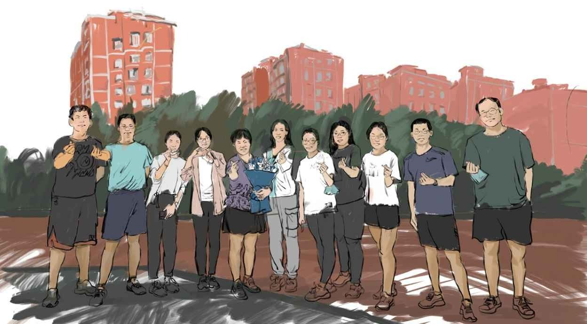



  <section class="about-hero">
    

      
About &middot; Research Centre of Distance Education

      <h1 class="about-hero__title">Jianjun Xiao 肖建军</h1>
      

        I am a Ph.D. candidate in Internet Education at the <a href="https://rcde.bnu.edu.cn/" target="_blank" rel="noopener">Research Centre of Distance Education (RCDE)</a>, <strong>Beijing Normal University</strong>, advised by <a href="https://fe.bnu.edu.cn/pc/cms1info/resume/51/94" target="_blank" rel="noopener">Prof. Li Chen</a>. My research investigates how learners interact, collaborate, and co-construct knowledge in open online learning environments and human&ndash;AI collaborative settings.
      

      

        Since 2019, I have designed and iterated China&rsquo;s first <a href="https://cmooc.bnu.edu.cn" target="_blank" rel="noopener">cMOOC platform</a> across nine course runs serving <strong>16,712+ learners</strong> and recording over <strong>1.2 million</strong> standardized learning behaviors. Methodologically, I integrate <strong>complex network modeling</strong>, <strong>natural language processing (NLP)</strong>, <strong>explainable AI</strong>, and <strong>design-based research (DBR)</strong>.
      

      <ul class="about-tags" aria-label="Research interests">
        <li>Connectivism &amp; cMOOCs</li>
        <li>Learning Analytics</li>
        <li>Complex Networks</li>
        <li>Human&ndash;AI Collaboration</li>
        <li>Explainable AI</li>
        <li>Design-Based Research</li>
      </ul>

      

        <a class="homepage-button" href="/assets/pdf/Xiao_Jianjun_Resume_EN.pdf">CV (English)</a>
        <a class="homepage-button homepage-button--secondary" href="/assets/pdf/Xiao_Jianjun_Resume_CN.pdf">CV (中文)</a>
      

    

    <aside class="about-aside">
      <figure class="about-portrait">
        
      </figure>
      <dl class="about-facts">
        

          <dt>Location</dt>
          <dd>Beijing, China</dd>
        

        

          <dt>Affiliation</dt>
          <dd>RCDE &middot; BNU</dd>
        

        

          <dt>Advisor</dt>
          <dd>Prof. Li Chen</dd>
        

        

          <dt>Expected Ph.D.</dt>
          <dd>Jun 2027</dd>
        

      </dl>
    </aside>
  </section>

  <section class="about-section" id="background">
    

      

        <h2 class="about-col__title">Education</h2>
        <ol class="about-timeline">
          <li>
            Sep 2023 &ndash; Jun 2027 (Expected)
            
Ph.D. Candidate in Internet Education

            
Beijing Normal University &middot; Faculty of Education (RCDE), Beijing

          </li>
          <li>
            Sep 2020 &ndash; Jun 2023
            
M.S. in Educational Technology

            
Beijing Normal University &middot; Beijing

          </li>
          <li>
            Sep 2014 &ndash; Jun 2018
            
B.Ed. in Educational Technology

            
Linyi University &middot; Shandong

          </li>
        </ol>
      

      

        <h2 class="about-col__title">Experience &amp; Teaching</h2>
        <ol class="about-timeline">
          <li>
            Jan 2019 &ndash; Present
            
Lead Platform Architect &amp; R&amp;D Engineer

            
Research Centre of Distance Education, BNU &middot; Designed and iterated China&rsquo;s first cMOOC platform across 9 course runs (16,712+ learners).

          </li>
          <li>
            Aug 2023
            
Team Lead &middot; iFLYTEK Spark Training Camp

            
Led a 6-member team in evaluating Spark LLM 2.5 and developing the Spark Shopping plugin (Bronze Award).

          </li>
          <li>
            Sep 2021 &ndash; Jan 2022
            
Teaching Assistant &middot; Data Management and Analysis

            
Undergraduate Public Restricted Course (35 students), Beijing Normal University.

          </li>
        </ol>
      

    

  </section>

  <section class="about-section" id="service">
    

      

        <h2 class="about-col__title">Academic Service &amp; Honors</h2>
        

          
Community &amp; Editorial

          

            Nominee, SoLAR Executive Committee Student Member (2026) &middot; Editorial Board Member, <a href="https://ojs.bonfuturepress.com/index.php/CETR/editorial_board#:~:text=Xiao%20Jianjun" target="_blank" rel="noopener">Contemporary Education and Teaching Research</a> (2025).
          

        

        

          
Selected Recognition

          

            Young Scholar Award at Wolfson College, University of Cambridge (2026) &middot; LAK26 Doctoral Consortium Participant (2026) &middot; First Prize, AI-Empowered Online Teaching Innovation Competition (2025) &middot; Best Paper, CAHE Learning Sciences Annual Conference (2025) &middot; Young Scholar Award, ASSRT at Kansai University (2024).
          

        

      

      
      

        <h2 class="about-col__title">Peer Review ({{ orcid_peer_reviews.review_count }} Reviews &middot; {{ orcid_peer_reviews.journal_count | default: orcid_peer_reviews.journals.size }} Journals)</h2>
        <ul class="about-review-pills">
          
            <li>
              <a class="service-pill" href="{{ journal.url }}" target="_blank" rel="noopener">
                {{ journal.title }}
                {{ journal.review_count }}
              </a>
            </li>
          
        </ul>
      

      
    

  </section>

  <section class="about-section about-section--climbers" id="climbers">
    <figure class="about-climbers">
      

        
      

      <figcaption class="about-climbers__caption">
        

          Community
          <h2 class="about-climbers__title">The Climbers</h2>
        

        Beijing Normal University &middot; September 2020
      </figcaption>
    </figure>
  </section>

