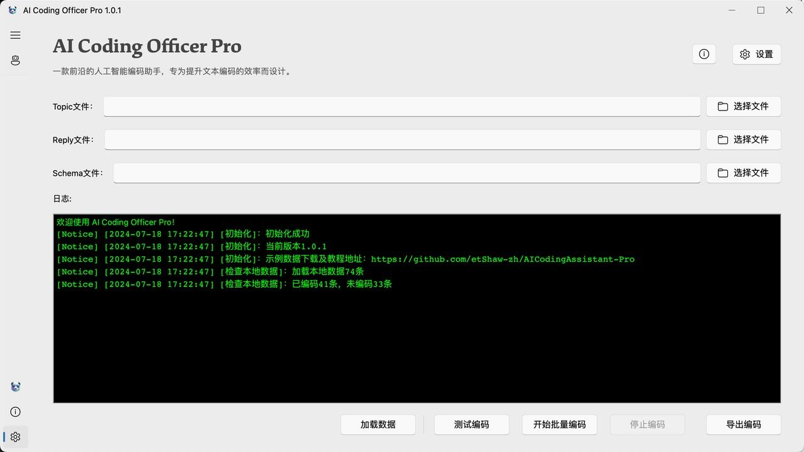












  <section class="homepage-hero homepage-hero--map" id="map">
    

      
PhD Candidate &middot; Faculty of Education, BNU

      <h1>Jianjun Xiao肖建军</h1>
      
How does online discussion become collaborative knowledge?

      
Combining <strong>learning analytics</strong> and <strong>complex networks</strong> to model how groups build knowledge together, and designing <strong>human–AI collaborative systems</strong> that support online collaborative learning.

      

        <a class="homepage-icon-btn" href="https://scholar.google.com/citations?hl=en&user=FaqCcFoAAAAJ" target="_blank" rel="noopener" title="Google Scholar" aria-label="Google Scholar">
          <i class="fas fa-graduation-cap" aria-hidden="true"></i>
        </a>
        <a class="homepage-icon-btn" href="https://orcid.org/0000-0003-0000-9630" target="_blank" rel="noopener" title="ORCID" aria-label="ORCID">
          <i class="fab fa-orcid" aria-hidden="true"></i>
        </a>
        <a class="homepage-icon-btn" href="https://github.com/etShaw-zh" target="_blank" rel="noopener" title="GitHub" aria-label="GitHub">
          <i class="fab fa-github" aria-hidden="true"></i>
        </a>
        <a class="homepage-icon-btn" href="https://linkedin.com/in/建军-肖-2947a6380" target="_blank" rel="noopener" title="LinkedIn" aria-label="LinkedIn">
          <i class="fab fa-linkedin-in" aria-hidden="true"></i>
        </a>
        <a class="homepage-icon-btn" href="mailto:jianjun.xiao@mail.bnu.edu.cn" title="Email" aria-label="Email">
          <i class="fas fa-envelope" aria-hidden="true"></i>
        </a>
        <a class="homepage-button" href="/assets/pdf/Xiao_Jianjun_Resume_EN.pdf">Download CV</a>
      

      

        

          
Total Citations &middot; Google Scholar
 
{{ total_citations }}

          
{{ paper_count }} papers mapped

        

        <dl class="homepage-metrics__secondary">
          

            <dt>ORCID Works</dt>
            <dd>{{ work_total }} {{ journal_articles }} journal &middot; {{ conference_outputs }} conf</dd>
          

          

            <dt>Peer Reviews</dt>
            <dd>{{ review_total }} / {{ journal_total }} journals</dd>
          

        </dl>
        

          <a href="#publications">Explore selected research &darr;</a>
        

      

    

    

      
    

  </section>

  <section class="homepage-section" id="publications">
    

      

        
02 / Publications

        <h2>Selected Publications</h2>
      

      

        <a class="homepage-section__link" href="https://orcid.org/0000-0003-0000-9630#cy-works" target="_blank" rel="noopener">ORCID &#8599;</a>
        <a class="homepage-section__link" href="https://scholar.google.com/citations?hl=en&user=FaqCcFoAAAAJ" target="_blank" rel="noopener">Google Scholar &#8599;</a>
      

    

    

    
  </section>

  
    <aside class="service-ribbon" id="service" aria-label="Journal peer reviewer list">
      

        Peer Reviewer
        {{ orcid_peer_reviews.review_count }} reviews &middot; {{ orcid_peer_reviews.journal_count | default: orcid_peer_reviews.journals.size }} journals
      

      <ul class="service-ribbon__list">
        
          <li class="service-pill--extra"><a class="service-pill" href="{{ journal.url }}" target="_blank" rel="noopener">{{ journal.title }}{{ journal.review_count }}</a></li>
        
          
            <li class="service-more"><button type="button" class="service-more__btn" data-service-more aria-expanded="false">+{{ orcid_peer_reviews.journals.size | minus: 5 }} more</button></li>
          
      </ul>
    </aside>
    
  

  <section class="homepage-section" id="news">
    

      

        
03 / Updates

        <h2>Latest News</h2>
      

      <a class="homepage-section__link" href="/life/">View all &rarr;</a>
    

    <ul class="news-list">
      
    </ul>
  </section>

  <section class="homepage-section" id="projects">
    

      

        
04 / Built Systems &amp; Tools

        <h2>Featured Projects</h2>
      

      <a class="homepage-section__link" href="/projects/">View all &rarr;</a>
    

    

      <article class="project-card">
        
        

          
01 &middot; WordPress &middot; 16,712+ users &middot; since 2019

          <h3>cMOOC Platform</h3>
          
Connectivist MOOC platform architecture and iteration supporting collaborative learning communities at BNU.

          

            <a href="https://cmooc.bnu.edu.cn" target="_blank" rel="noopener">Visit platform &#8599;</a>
          

        

      </article>

      <article class="project-card">
        
        

          
02 &middot; PyQt6 &middot; Open Source &middot; Win / macOS / Linux

          <h3>AICodingOfficer (AICO)</h3>
          
Cross-platform AI text-coding assistant with integrated classifiers for qualitative discourse analysis.

          

            <a href="/aicodingofficer/">Overview &rarr;</a>
            <a href="https://github.com/etShaw-zh/AICodingAssistant-Pro/releases" target="_blank" rel="noopener">Releases &#8599;</a>
          

        

      </article>

      <article class="project-card">
        
        

          
03 &middot; Human&ndash;AI Workflow &middot; DBR &middot; 2026

          <h3>FaciHub</h3>
          
AI-in-the-loop discussion facilitation workflow for cMOOCs: AI drafts replies, humans review them; tested with 178 participants across two design iterations.

          

            <a href="https://arxiv.org/abs/2603.29285v2" target="_blank" rel="noopener">Paper (arXiv) &#8599;</a>
            <a href="https://arxiv.org/pdf/2603.29285v2.pdf" target="_blank" rel="noopener">PDF &#8599;</a>
          

        

      </article>
    

  </section>

  <section class="homepage-section homepage-contact" id="contact">
    

      

        
05 / Connect

        <h2>Get in Touch</h2>
        
Open to research collaborations, invited talks, and peer review inquiries &middot; RCDE, Beijing Normal University.

        

          <a class="contact-chip" href="mailto:jianjun.xiao@mail.bnu.edu.cn">Emailjianjun.xiao@mail.bnu.edu.cn</a>
          <a class="contact-chip" href="https://scholar.google.com/citations?hl=en&user=FaqCcFoAAAAJ" target="_blank" rel="noopener">ScholarProfile &#8599;</a>
          <a class="contact-chip" href="https://orcid.org/0000-0003-0000-9630" target="_blank" rel="noopener">ORCID0000-0003-0000-9630</a>
          <a class="contact-chip" href="https://github.com/etShaw-zh" target="_blank" rel="noopener">GitHub@etShaw-zh</a>
          <a class="contact-chip" href="https://linkedin.com/in/建军-肖-2947a6380" target="_blank" rel="noopener">LinkedInProfile &#8599;</a>
          <a class="contact-chip" href="https://rcde.bnu.edu.cn/" target="_blank" rel="noopener">LabRCDE &middot; BNU &#8599;</a>
        

        

          <a class="homepage-button" href="/assets/pdf/Xiao_Jianjun_Resume_EN.pdf">CV (English)</a>
          <a class="homepage-button homepage-button--secondary" href="/assets/pdf/Xiao_Jianjun_Resume_CN.pdf">CV (中文)</a>
        

      

      

        

          Visitors &middot; Flag Map
          <a class="visitor-map-card__link" href="https://info.flagcounter.com/hnzv" target="_blank" rel="noopener">Stats &#8599;</a>
        

        
      

    

  </section>

