













  <section class="homepage-hero homepage-hero--map" id="map">
    

      
PhD Candidate &middot; Faculty of Education, BNU

      <h1>Jianjun Xiao肖建军</h1>
      
Researching how people learn, collaborate, and create knowledge in digitally mediated environments—bridging <strong>learning analytics</strong>, <strong>complex networks</strong>, and <strong>human–AI collaboration</strong>.

      

        <a class="homepage-icon-btn" href="https://scholar.google.com/citations?hl=zh-CN&user=FaqCcFoAAAAJ" target="_blank" rel="noopener" title="Google Scholar" aria-label="Google Scholar">
          <i class="fas fa-graduation-cap" aria-hidden="true"></i>
        </a>
        <a class="homepage-icon-btn" href="https://orcid.org/0000-0003-0000-9630" target="_blank" rel="noopener" title="ORCID" aria-label="ORCID">
          <i class="fab fa-orcid" aria-hidden="true"></i>
        </a>
        <a class="homepage-icon-btn" href="https://github.com/etShaw-zh" target="_blank" rel="noopener" title="GitHub" aria-label="GitHub">
          <i class="fab fa-github" aria-hidden="true"></i>
        </a>
        <a class="homepage-icon-btn" href="https://linkedin.com/in/建军-肖-2947a6380" target="_blank" rel="noopener" title="LinkedIn" aria-label="LinkedIn">
          <i class="fab fa-linkedin-in" aria-hidden="true"></i>
        </a>
        <a class="homepage-icon-btn" href="mailto:et_shaw@126.com" title="Email" aria-label="Email">
          <i class="fas fa-envelope" aria-hidden="true"></i>
        </a>
        <a class="homepage-button" href="/assets/pdf/Xiao_Jianjun_Resume_EN.pdf">Download CV</a>
      

      

        

          
Total Citations &middot; Google Scholar

          
{{ total_citations }}

          
h-index {{ h_index }} &middot; i10-index {{ i10_index }} &middot; {{ paper_count }} papers mapped

        

        <dl class="homepage-metrics__secondary">
          

            <dt>ORCID Works</dt>
            <dd>{{ work_total }} {{ journal_articles }} journal &middot; {{ conference_outputs }} conf</dd>
          

          

            <dt>Peer Reviews</dt>
            <dd>{{ review_total }} / {{ journal_total }} journals</dd>
          

        </dl>
        

          <a href="#news">Latest updates &darr;</a>
        

      

    

    

      
    

  </section>

  
    <aside class="service-ribbon" id="service" aria-label="Journal peer reviewer list">
      

        Peer Reviewer
        {{ orcid_peer_reviews.review_count }} &middot; {{ orcid_peer_reviews.journal_count | default: orcid_peer_reviews.journals.size }} journals
      

      

        

          <ul class="service-marquee__group">
            
              <li><a class="service-pill" href="{{ journal.url }}" target="_blank" rel="noopener">{{ journal.title }}{{ journal.review_count }}</a></li>
            
          </ul>
          <ul class="service-marquee__group" aria-hidden="true">
            
              <li><a class="service-pill" href="{{ journal.url }}" target="_blank" rel="noopener" tabindex="-1">{{ journal.title }}{{ journal.review_count }}</a></li>
            
          </ul>
        

      

    </aside>
  

  <section class="homepage-section" id="news">
    

      

        
02 / Updates

        <h2>Latest News</h2>
      

      <a class="homepage-section__link" href="/life/">View all &rarr;</a>
    

    <ul class="news-list">
      
    </ul>
  </section>

  <section class="homepage-section" id="publications">
    

      

        
03 / Publications

        <h2>Selected Publications</h2>
      

      

        <a class="homepage-section__link" href="https://orcid.org/0000-0003-0000-9630#cy-works" target="_blank" rel="noopener">ORCID &#8599;</a>
        <a class="homepage-section__link" href="https://scholar.google.com/citations?hl=zh-CN&user=FaqCcFoAAAAJ" target="_blank" rel="noopener">Google Scholar &#8599;</a>
      

    

    
    
    

    

      <article class="rg-pub-entry">
        

          

            01
            LAK26 &middot; Bergen, Norway &middot; 2026
            Full Research Paper
            {{ c_lak }} cites
          

          

            <a class="rg-pub-entry__link rg-pub-entry__link--muted" href="https://arxiv.org/pdf/2512.13061.pdf" target="_blank" rel="noopener">PDF &#8599;</a>
            <a class="rg-pub-entry__link" href="https://doi.org/10.1145/3785022.3785049" target="_blank" rel="noopener">DOI &#8599;</a>
          

        

        <h3 class="rg-pub-entry__title">Modeling collaborative problem solving dynamics from group discourse: A text-mining approach with synergy degree model</h3>
        
<strong>Xiao, J.</strong>, Wang, C., &amp; Zhang, W. &mdash; Automated CPS discourse coding &amp; Synergy Degree Modeling validated via permutation tests and ANOVA (<em>p</em> = .023).

        

          

            Extracted Figures &amp; Tables &middot; 5
            

              <button type="button" class="rg-figures-nav" data-rg-prev aria-label="Scroll figures left">&#8249;</button>
              <button type="button" class="rg-figures-nav" data-rg-next aria-label="Scroll figures right">&#8250;</button>
            

          

          

            <button type="button" class="rg-figure-tile" data-zoom-group="lak26" data-zoom-img="/assets/img/photos/2026/figures/lak26-fig1-pipeline.jpg" data-zoom-caption="LAK26 · Figure 1 — The research design and procedure: data collection, automated CPS classification, Synergy Degree Modeling, and comparative analysis">
              
                FIG
                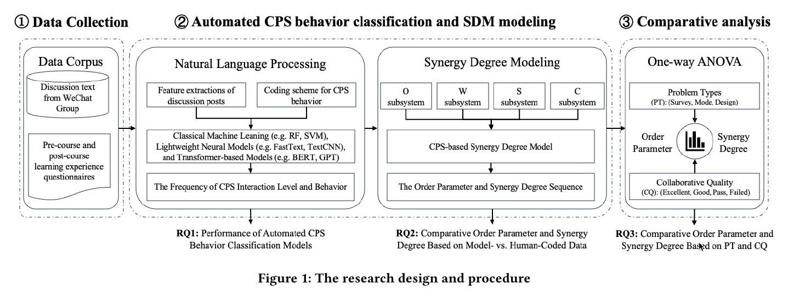
              
              Fig. 1 &middot; Research Design
            </button>
            <button type="button" class="rg-figure-tile" data-zoom-group="lak26" data-zoom-img="/assets/img/photos/2026/figures/lak26-table3-models.jpg" data-zoom-caption="LAK26 · Table 3 — Mean and standard deviation of model performance (LLMs, Neural Models, Classical ML) on CPS behavior classification">
              
                TABLE
                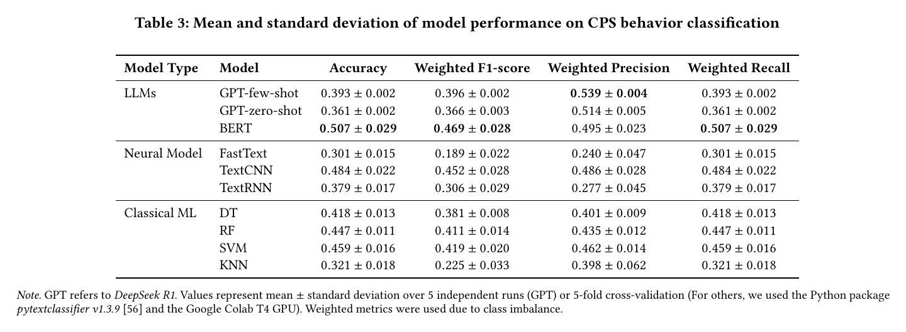
              
              Table 3 &middot; Model Perf.
            </button>
            <button type="button" class="rg-figure-tile" data-zoom-group="lak26" data-zoom-img="/assets/img/photos/2026/figures/lak26-fig2-permutation.jpg" data-zoom-caption="LAK26 · Figure 2 — Permutation test of CPS order parameters (O, W, S, C) and synergy degree between Human vs. Model coding">
              
                FIG
                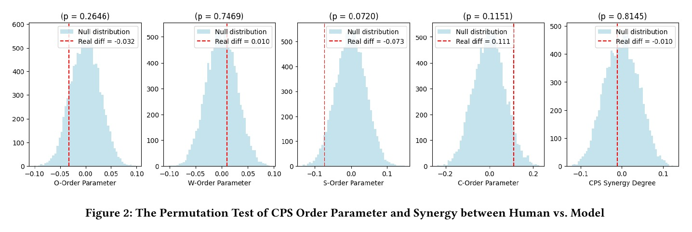
              
              Fig. 2 &middot; Permutation Test
            </button>
            <button type="button" class="rg-figure-tile" data-zoom-group="lak26" data-zoom-img="/assets/img/photos/2026/figures/lak26-table5-synergy.jpg" data-zoom-caption="LAK26 · Table 5 — Descriptive statistics of CPS order parameters and synergy degree across Problem Types (PT) and Collaborative Quality (CQ)">
              
                TABLE
                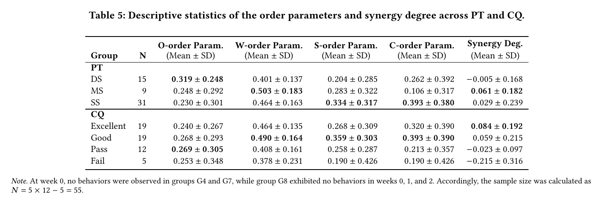
              
              Table 5 &middot; Synergy Stats
            </button>
            <button type="button" class="rg-figure-tile" data-zoom-group="lak26" data-zoom-img="/assets/img/photos/2026/figures/lak26-table6-anova.jpg" data-zoom-caption="LAK26 · Table 6 — Significant group differences (Kruskal-Wallis & Fisher ANOVA) across Problem Types and Collaborative Quality">
              
                TABLE
                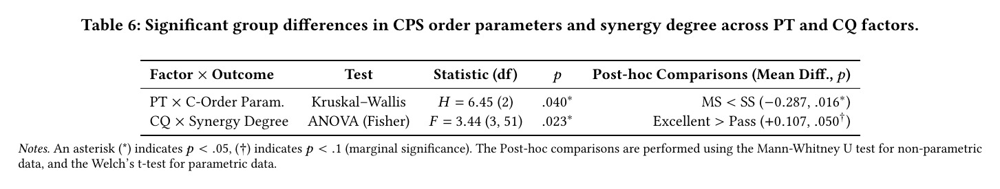
              
              Table 6 &middot; Group ANOVA
            </button>
          

        

      </article>

      <article class="rg-pub-entry">
        

          

            02
            Interactive Learning Environments &middot; 2026
            SSCI Q1 &middot; Solo
            {{ c_ile26 }} cites
          

          

            <a class="rg-pub-entry__link" href="https://doi.org/10.1080/10494820.2026.2632766" target="_blank" rel="noopener">DOI &#8599;</a>
          

        

        <h3 class="rg-pub-entry__title">Exploring interaction patterns in open learning environments: integrating network dynamics and cognitive engagement</h3>
        
<strong>Xiao, J.&dagger;</strong> &mdash; Relational Event Modeling across 8 cMOOC iterations (1,939 learners, 39,000+ interaction events) revealing reciprocity &times; cognitive engagement effects.

        

          

            Extracted Figures &amp; Tables &middot; 6
            

              <button type="button" class="rg-figures-nav" data-rg-prev aria-label="Scroll figures left">&#8249;</button>
              <button type="button" class="rg-figures-nav" data-rg-next aria-label="Scroll figures right">&#8250;</button>
            

          

          

            <button type="button" class="rg-figure-tile" data-zoom-group="ile26" data-zoom-img="/assets/img/photos/2026/figures/ile26-fig1-framework.jpg" data-zoom-caption="ILE (2026) · Figure 1 — REMs analysis of reciprocity and interaction levels in cMOOCs (Theoretical Framework)">
              
                FIG
                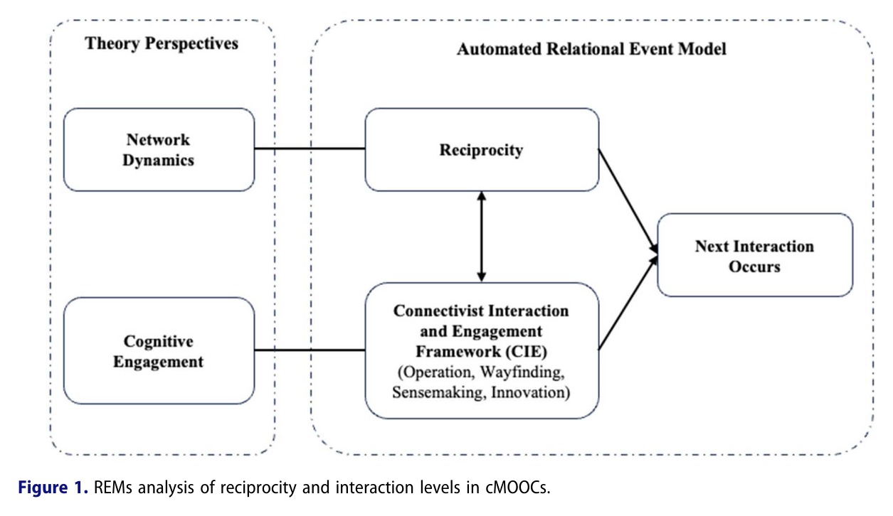
              
              Fig. 1 &middot; REM Framework
            </button>
            <button type="button" class="rg-figure-tile" data-zoom-group="ile26" data-zoom-img="/assets/img/photos/2026/figures/ile26-fig2-design.jpg" data-zoom-caption="ILE (2026) · Figure 2 — Diagram of the research design: NLP CIE classification, Relational Event Modeling, and multivariate meta-analysis">
              
                FIG
                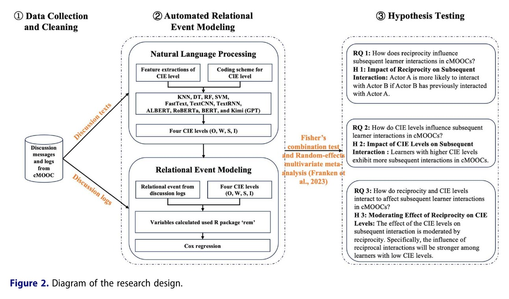
              
              Fig. 2 &middot; Research Design
            </button>
            <button type="button" class="rg-figure-tile" data-zoom-group="ile26" data-zoom-img="/assets/img/photos/2026/figures/ile26-fig4-cie.jpg" data-zoom-caption="ILE (2026) · Figure 4 — Percentage of discussion posts by CIE cognitive engagement level across 8 cMOOC iterations">
              
                FIG
                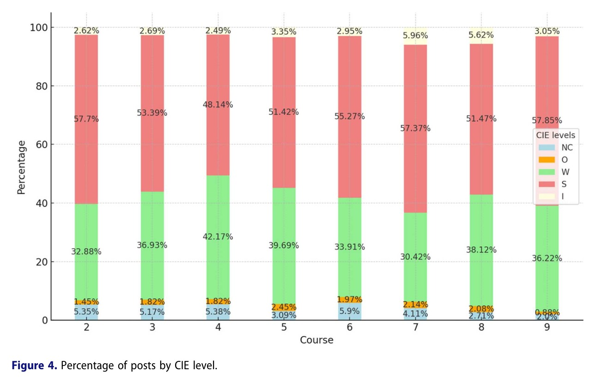
              
              Fig. 4 &middot; CIE Distribution
            </button>
            <button type="button" class="rg-figure-tile" data-zoom-group="ile26" data-zoom-img="/assets/img/photos/2026/figures/ile26-fig5-marginal.jpg" data-zoom-caption="ILE (2026) · Figure 5 — Marginal effects plot for the interaction effect of CIE levels and reciprocity on subsequent interactions">
              
                FIG
                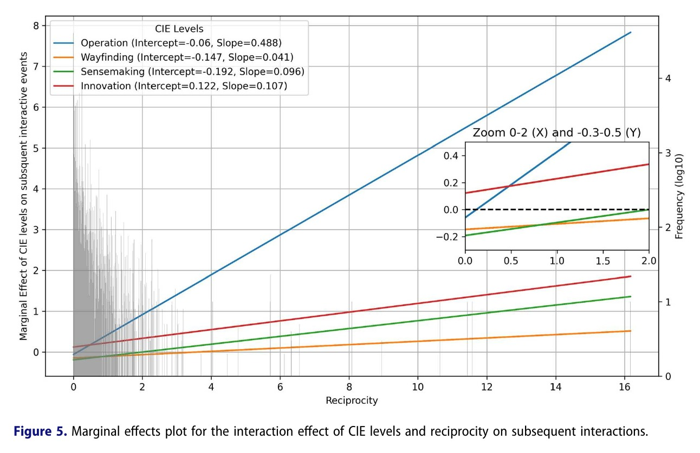
              
              Fig. 5 &middot; Marginal Effects
            </button>
            <button type="button" class="rg-figure-tile" data-zoom-group="ile26" data-zoom-img="/assets/img/photos/2026/figures/ile26-table2-rem.jpg" data-zoom-caption="ILE (2026) · Table 2 — Meta-analysis of parameter estimates for REMs on reciprocate and CIE level across Courses 2–9">
              
                TABLE
                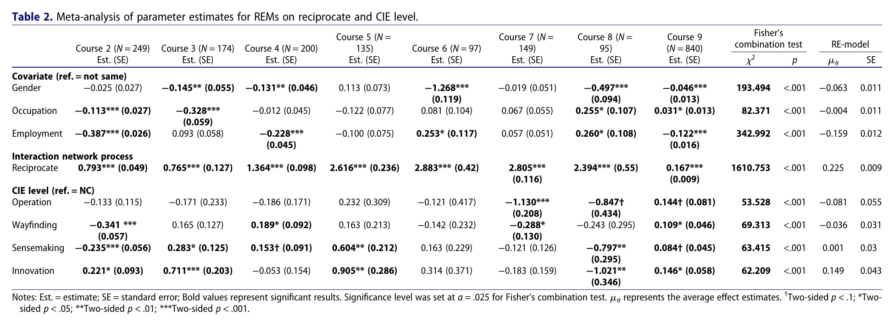
              
              Table 2 &middot; REM Meta
            </button>
            <button type="button" class="rg-figure-tile" data-zoom-group="ile26" data-zoom-img="/assets/img/photos/2026/figures/ile26-table3-interaction.jpg" data-zoom-caption="ILE (2026) · Table 3 — Meta-analysis of parameter estimates for REMs on reciprocate with interaction effect on CIE level">
              
                TABLE
                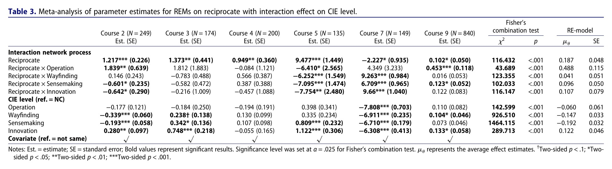
              
              Table 3 &middot; Interaction Meta
            </button>
          

        

      </article>

      <article class="rg-pub-entry">
        

          

            03
            arXiv Preprint &middot; 2026
            Human–GenAI &middot; DBR
            {{ c_pca }} cites
          

          

            <a class="rg-pub-entry__link rg-pub-entry__link--muted" href="https://arxiv.org/pdf/2603.29285v2.pdf" target="_blank" rel="noopener">PDF &#8599;</a>
            <a class="rg-pub-entry__link" href="https://arxiv.org/abs/2603.29285v2" target="_blank" rel="noopener">arXiv &#8599;</a>
          

        

        <h3 class="rg-pub-entry__title">Designing human-GenAI interaction for cMOOC discussion facilitation: Effects of a collaborative AI-in-the-loop workflow on social and cognitive presence</h3>
        
<strong>Xiao, J.</strong>, &amp; Wang, C. &mdash; Two-iteration DBR developing <em>FaciHub</em>, showing significant social presence gains across authentic cMOOC discussions (<em>n</em> = 178).

        

          

            Extracted Figures &amp; Tables &middot; 6
            

              <button type="button" class="rg-figures-nav" data-rg-prev aria-label="Scroll figures left">&#8249;</button>
              <button type="button" class="rg-figures-nav" data-rg-next aria-label="Scroll figures right">&#8250;</button>
            

          

          

            <button type="button" class="rg-figure-tile" data-zoom-group="pca26" data-zoom-img="/assets/img/photos/2026/figures/pca26-fig1-workflow.jpg" data-zoom-caption="arXiv (2026) · Figure 1 — Workflow structure for PCA target selection, multi-role response generation, and human review in FaciHub">
              
                FIG
                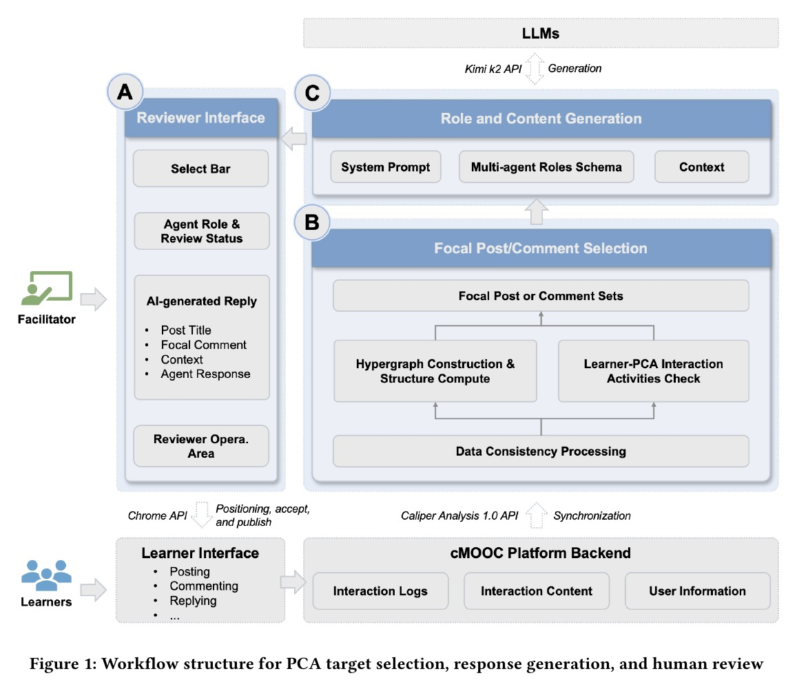
              
              Fig. 1 &middot; FaciHub Flow
            </button>
            <button type="button" class="rg-figure-tile" data-zoom-group="pca26" data-zoom-img="/assets/img/photos/2026/figures/pca26-fig2-interface.jpg" data-zoom-caption="arXiv (2026) · Figure 2 — FaciHub interface for contextual inspection and human approval of PCA-generated replies">
              
                FIG
                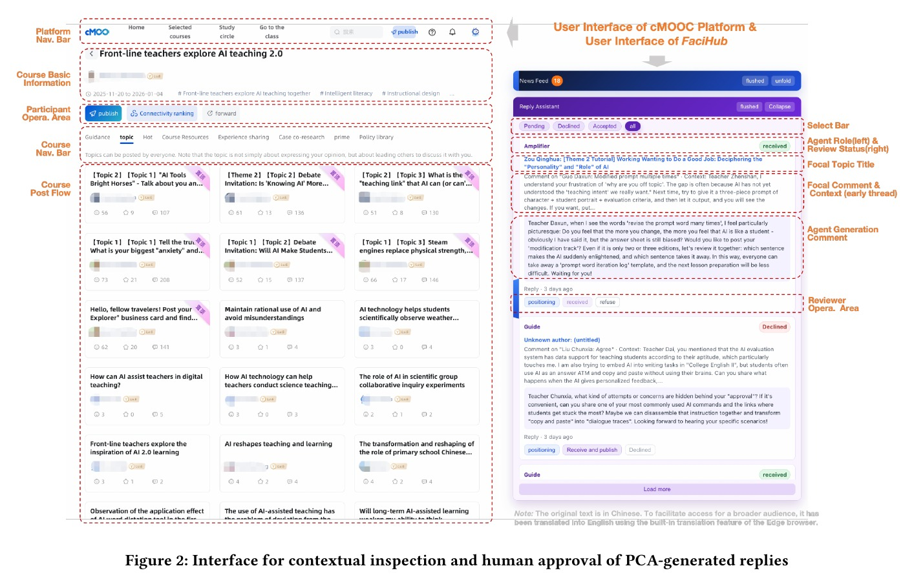
              
              Fig. 2 &middot; FaciHub UI
            </button>
            <button type="button" class="rg-figure-tile" data-zoom-group="pca26" data-zoom-img="/assets/img/photos/2026/figures/pca26-fig3-hypergraph.jpg" data-zoom-caption="arXiv (2026) · Figure 3 — Example of hypergraph-based target selection for PCA discussion participation">
              
                FIG
                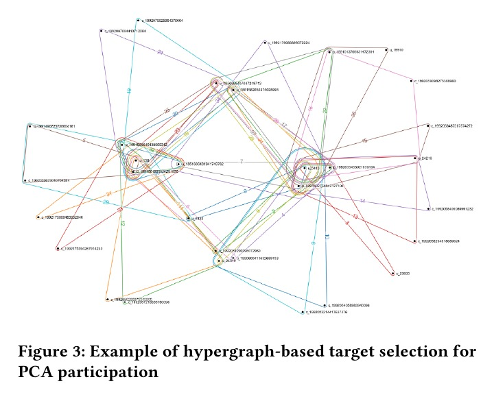
              
              Fig. 3 &middot; Hypergraph
            </button>
            <button type="button" class="rg-figure-tile" data-zoom-group="pca26" data-zoom-img="/assets/img/photos/2026/figures/pca26-fig4-dbr.jpg" data-zoom-caption="arXiv (2026) · Figure 4 — Overview of the two-iteration Design-Based Research procedure aligned with Reeves' (2006) four-phase model">
              
                FIG
                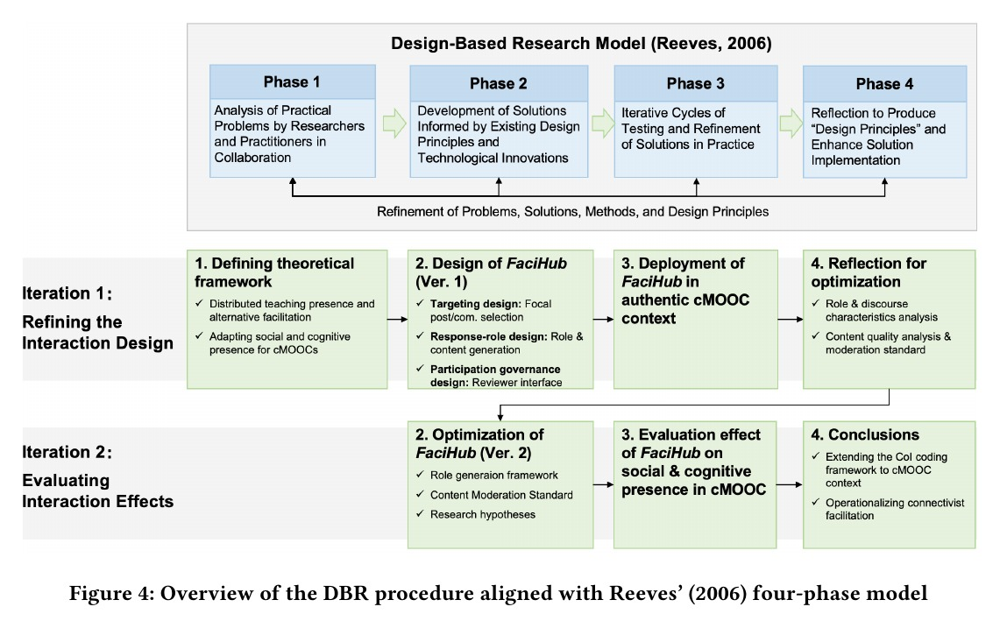
              
              Fig. 4 &middot; DBR Procedure
            </button>
            <button type="button" class="rg-figure-tile" data-zoom-group="pca26" data-zoom-img="/assets/img/photos/2026/figures/pca26-fig6-daily.jpg" data-zoom-caption="arXiv (2026) · Figure 6 — Daily distribution of PCA-generated responses, facilitator review outcomes, and role composition">
              
                FIG
                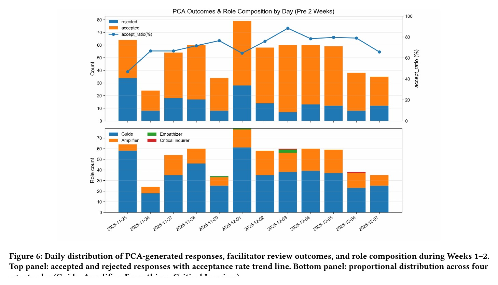
              
              Fig. 6 &middot; Daily Outcomes
            </button>
            <button type="button" class="rg-figure-tile" data-zoom-group="pca26" data-zoom-img="/assets/img/photos/2026/figures/pca26-tables56-results.jpg" data-zoom-caption="arXiv (2026) · Tables 5 & 6 — Goal 1 (With-PCA vs. Without-PCA) and Goal 2 (Direct vs. Co-Presence) social & cognitive presence results">
              
                TABLE
                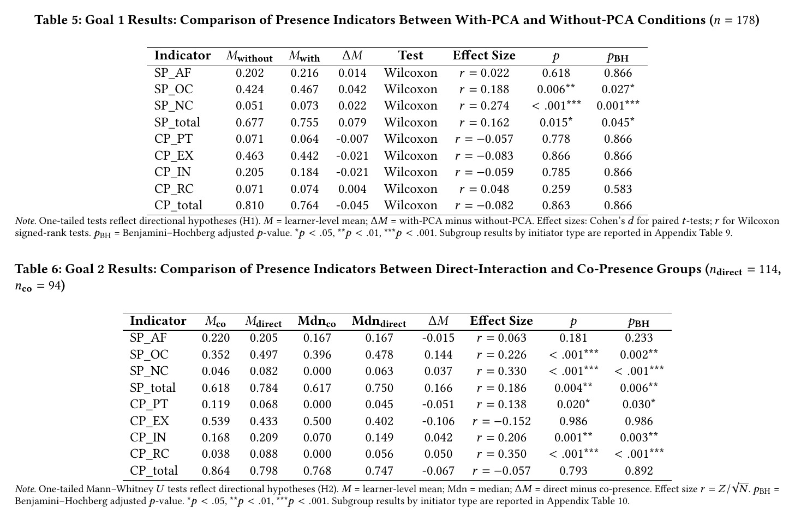
              
              Tables 5–6 &middot; Presence
            </button>
          

        

      </article>
    

    
  </section>

  <section class="homepage-section" id="projects">
    

      

        
04 / Built Systems &amp; Tools

        <h2>Featured Projects</h2>
      

      <a class="homepage-section__link" href="/projects/">View all &rarr;</a>
    

    

      <article class="project-card">
        
        

          
01 &middot; WordPress &middot; 16,712+ users &middot; since 2019

          <h3>cMOOC Platform</h3>
          
Connectivist MOOC platform architecture and iteration supporting collaborative learning communities at BNU.

          

            <a href="https://cmooc.bnu.edu.cn" target="_blank" rel="noopener">Visit platform &#8599;</a>
          

        

      </article>

      <article class="project-card">
        
        

          
02 &middot; PyQt6 &middot; Open Source &middot; Win / macOS / Linux

          <h3>AICodingOfficer (AICO)</h3>
          
Cross-platform AI text-coding assistant with integrated classifiers for qualitative discourse analysis.

          

            <a href="/aicodingofficer/">Overview &rarr;</a>
            <a href="https://github.com/etShaw-zh/AICodingAssistant-Pro/releases" target="_blank" rel="noopener">Releases &#8599;</a>
          

        

      </article>

      <article class="project-card">
        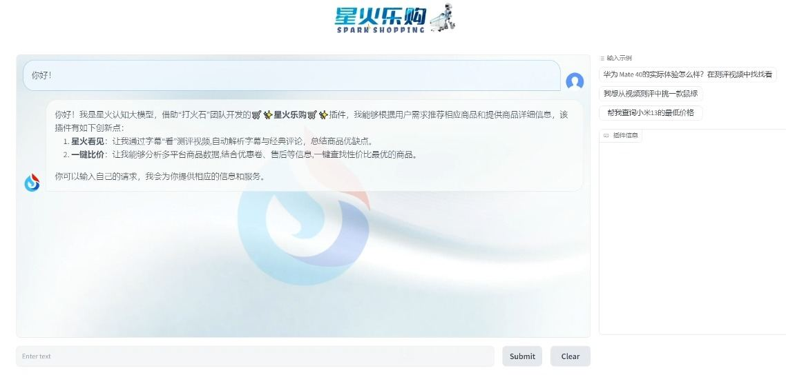
        

          
03 &middot; LLM Agent &middot; Bronze Award &middot; 2023

          <h3>Spark Shopping</h3>
          
LLM shopping assistant developed in the iFLYTEK Spark Training Camp and awarded in the General AI Innovation Competition.

          

            <a href="https://mp.weixin.qq.com/s/IGBmPkI9BBRgLGWiW0jFCQ" target="_blank" rel="noopener">Award report &#8599;</a>
          

        

      </article>
    

  </section>

  <section class="homepage-section homepage-contact" id="contact">
    

      

        
05 / Connect

        <h2>Get in Touch</h2>
        
Open to research collaborations, invited talks, and peer review inquiries &middot; RCDE, Beijing Normal University.

        

          <a class="contact-chip" href="mailto:et_shaw@126.com">Emailet_shaw@126.com</a>
          <a class="contact-chip" href="https://scholar.google.com/citations?hl=zh-CN&user=FaqCcFoAAAAJ" target="_blank" rel="noopener">Scholar{{ total_citations }} cites</a>
          <a class="contact-chip" href="https://orcid.org/0000-0003-0000-9630" target="_blank" rel="noopener">ORCID0000-0003-0000-9630</a>
          <a class="contact-chip" href="https://github.com/etShaw-zh" target="_blank" rel="noopener">GitHub@etShaw-zh</a>
          <a class="contact-chip" href="https://linkedin.com/in/建军-肖-2947a6380" target="_blank" rel="noopener">LinkedInProfile &#8599;</a>
          <a class="contact-chip" href="https://rcde.bnu.edu.cn/" target="_blank" rel="noopener">LabRCDE &middot; BNU &#8599;</a>
        

        

          <a class="homepage-button" href="/assets/pdf/Xiao_Jianjun_Resume_EN.pdf">CV (English)</a>
          <a class="homepage-button homepage-button--secondary" href="/assets/pdf/Xiao_Jianjun_Resume_CN.pdf">CV (中文)</a>
        

      

      

        

          Visitors &middot; Flag Map
          <a class="visitor-map-card__link" href="https://info.flagcounter.com/hnzv" target="_blank" rel="noopener">Stats &#8599;</a>
        

        
      

    

  </section>

