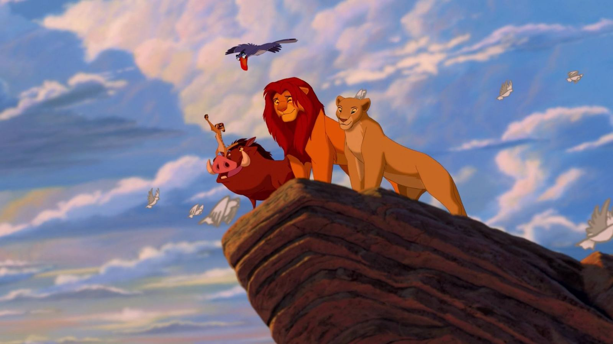
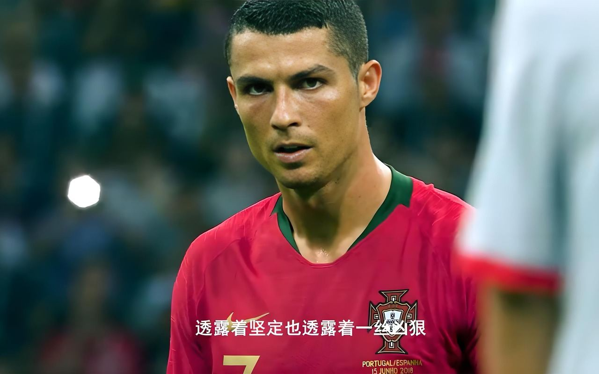

I'd like to share a moving scene from the movie **"[The Lion King](https://en.wikipedia.org/wiki/The_Lion_King){:target="_blank"},"** that has inspired me to move forward with courage and to understand my responsibilities more deeply.

---

During the 2018 World Cup, a special moment was born from the match between Portugal and Spain. **[CR 7](https://en.wikipedia.org/wiki/Cristiano_Ronaldo){:target="_blank"}**'s gaze was strong and deep, and it reminded me of an old poem: "男儿何不带吴钩,收取关山五十州." It shows the spirit of moving forward bravely and conquering challenges, which is why I admire him so much.

