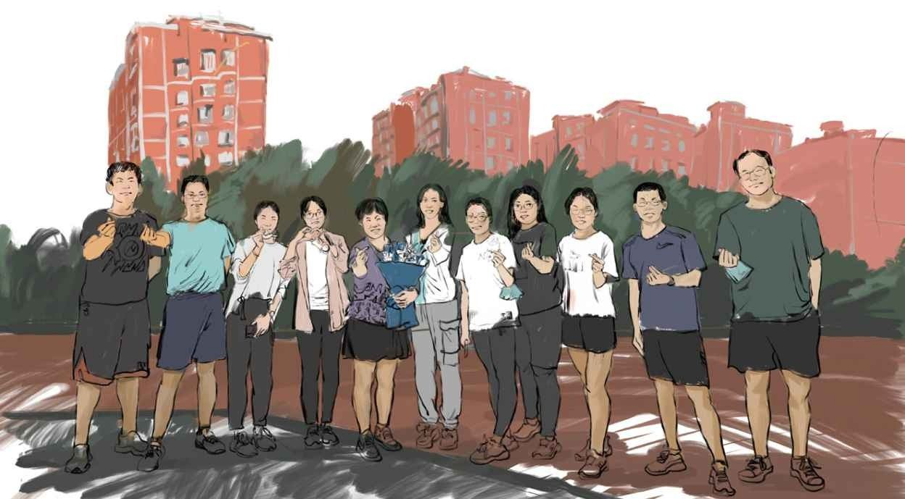



  <section class="about-hero">
    

      
关于我 &middot; 北京师范大学远程教育研究中心

      <h1 class="about-hero__title">肖建军 Jianjun Xiao</h1>
      

        我是肖建军，现为<strong>北京师范大学</strong><a href="https://rcde.bnu.edu.cn/" target="_blank" rel="noopener">远程教育研究中心（RCDE）</a>互联网教育方向博士研究生，师从<a href="https://fe.bnu.edu.cn/pc/cms1info/resume/51/94" target="_blank" rel="noopener">陈丽教授</a>。我的研究聚焦于开放学习环境与人机协同场景下学习者的交互机制、协作问题解决与知识共创过程。
      

      

        自 2019 年起，我主导国内首门 <a href="https://cmooc.bnu.edu.cn" target="_blank" rel="noopener">cMOOC 平台</a> 的设计与迭代研发，支撑 9 轮课程运行，累计服务 <strong>16,712+ 名学习者</strong>并采集超过 <strong>120 万条</strong>规范化学习行为记录。研究方法上结合<strong>复杂网络建模</strong>、<strong>自然语言处理（NLP）</strong>、<strong>可解释人工智能</strong>与<strong>基于设计的研究（DBR）</strong>。
      

      <ul class="about-tags" aria-label="研究兴趣">
        <li>联通主义与 cMOOC</li>
        <li>学习分析</li>
        <li>复杂网络建模</li>
        <li>人机协同学习</li>
        <li>可解释人工智能</li>
        <li>基于设计的研究</li>
      </ul>

      

        <a class="homepage-button" href="/assets/pdf/Xiao_Jianjun_Resume_CN.pdf">中文简历</a>
        <a class="homepage-button homepage-button--secondary" href="/assets/pdf/Xiao_Jianjun_Resume_EN.pdf">English CV</a>
      

    

    <aside class="about-aside">
      <figure class="about-portrait">
        
      </figure>
      <dl class="about-facts">
        

          <dt>所在地</dt>
          <dd>中国 &middot; 北京</dd>
        

        

          <dt>所属机构</dt>
          <dd>北师大 RCDE</dd>
        

        

          <dt>导师</dt>
          <dd>陈丽 教授</dd>
        

        

          <dt>预计毕业</dt>
          <dd>2027 年 6 月</dd>
        

      </dl>
    </aside>
  </section>

  <section class="about-section" id="background">
    

      

        <h2 class="about-col__title">教育背景</h2>
        <ol class="about-timeline">
          <li>
            2023.09 &ndash; 2027.06（预计）
            
互联网教育 &middot; 博士研究生

            
北京师范大学教育学部 &middot; 远程教育研究中心（RCDE），北京

          </li>
          <li>
            2020.09 &ndash; 2023.06
            
教育技术学 &middot; 理学硕士

            
北京师范大学，北京

          </li>
          <li>
            2014.09 &ndash; 2018.06
            
教育技术学 &middot; 教育学学士

            
临沂大学，山东

          </li>
        </ol>
      

      

        <h2 class="about-col__title">研发与教学经历</h2>
        <ol class="about-timeline">
          <li>
            2019.01 &ndash; 至今
            
研究助理 &amp; 平台主研发工程师

            
北京师范大学远程教育研究中心 &middot; 主导 cMOOC 平台设计与功能迭代，支撑 9 轮课程运行与 16,712+ 学习者实践。

          </li>
          <li>
            2023.08
            
小组负责人 &middot; 科大讯飞星火训练营

            
带领 6 人团队完成星火大模型 2.5 能力评测与购物助手插件开发，获训练营与创新竞赛三等奖。

          </li>
          <li>
            2021.09 &ndash; 2022.01
            
教学助理 &middot; 《数据管理与分析》

            
北京师范大学本科公共限选课（35 名学生）。

          </li>
        </ol>
      

    

  </section>

  <section class="about-section" id="service">
    

      

        <h2 class="about-col__title">学术服务与荣誉</h2>
        

          
学术兼职与编委

          

            SoLAR Executive Committee 学生委员候选人（2026） &middot; 《<a href="https://ojs.bonfuturepress.com/index.php/CETR/editorial_board#:~:text=Xiao%20Jianjun" target="_blank" rel="noopener">Contemporary Education and Teaching Research</a>》编委（2025）。
          

        

        

          
代表获奖与入选

          

            剑桥大学沃尔夫森学院青年学者奖（2026） &middot; LAK26 Doctoral Consortium 入选（2026） &middot; AI 赋能在线教学创新大赛一等奖（2025） &middot; 中国高等教育学会学习科学研究分会年会优秀论文（2025） &middot; 关西大学 ASSRT 青年学者奖（2024）。
          

        

      

      
      

        <h2 class="about-col__title">国际期刊审稿（{{ orcid_peer_reviews.review_count }} 次 &middot; {{ orcid_peer_reviews.journal_count | default: orcid_peer_reviews.journals.size }} 刊）</h2>
        <ul class="about-review-pills">
          
            <li>
              <a class="service-pill" href="{{ journal.url }}" target="_blank" rel="noopener">
                {{ journal.title }}
                {{ journal.review_count }}
              </a>
            </li>
          
        </ul>
      

      
    

  </section>

  <section class="about-section about-section--climbers" id="climbers">
    <figure class="about-climbers">
      

        
      

      <figcaption class="about-climbers__caption">
        

          同行伙伴
          <h2 class="about-climbers__title">The Climbers</h2>
        

        北京师范大学 &middot; 2020 年 9 月
      </figcaption>
    </figure>
  </section>

