













  <section class="homepage-hero homepage-hero--map" id="map">
    

      
博士研究生 &middot; 北京师范大学教育学部

      <h1>肖建军Jianjun Xiao</h1>
      
关注数字化学习环境中的学习、协作与知识创造，致力于将<strong>学习分析</strong>、<strong>复杂网络建模</strong>与<strong>人机协作人工智能</strong>融入教育实践。

      

        <a class="homepage-icon-btn" href="https://scholar.google.com/citations?hl=zh-CN&user=FaqCcFoAAAAJ" target="_blank" rel="noopener" title="Google Scholar" aria-label="Google Scholar">
          <i class="fas fa-graduation-cap" aria-hidden="true"></i>
        </a>
        <a class="homepage-icon-btn" href="https://orcid.org/0000-0003-0000-9630" target="_blank" rel="noopener" title="ORCID" aria-label="ORCID">
          <i class="fab fa-orcid" aria-hidden="true"></i>
        </a>
        <a class="homepage-icon-btn" href="https://github.com/etShaw-zh" target="_blank" rel="noopener" title="GitHub" aria-label="GitHub">
          <i class="fab fa-github" aria-hidden="true"></i>
        </a>
        <a class="homepage-icon-btn" href="https://linkedin.com/in/建军-肖-2947a6380" target="_blank" rel="noopener" title="LinkedIn" aria-label="LinkedIn">
          <i class="fab fa-linkedin-in" aria-hidden="true"></i>
        </a>
        <a class="homepage-icon-btn" href="mailto:et_shaw@126.com" title="电子邮箱" aria-label="电子邮箱">
          <i class="fas fa-envelope" aria-hidden="true"></i>
        </a>
        <a class="homepage-button" href="/assets/pdf/Xiao_Jianjun_Resume_CN.pdf">下载简历</a>
      

      

        

          
论文总引用 &middot; Google Scholar

          
{{ total_citations }}

          
h-index {{ h_index }} &middot; i10-index {{ i10_index }} &middot; 星图收录 {{ paper_count }} 篇论文

        

        <dl class="homepage-metrics__secondary">
          

            <dt>ORCID 成果</dt>
            <dd>{{ work_total }} {{ journal_articles }} 期刊 &middot; {{ conference_outputs }} 会议</dd>
          

          

            <dt>国际期刊审稿</dt>
            <dd>{{ review_total }} 次 / {{ journal_total }} 刊</dd>
          

        </dl>
        

          <a href="#news">查看最新动态 &darr;</a>
        

      

    

    

      
    

  </section>

  
    <aside class="service-ribbon" id="service" aria-label="期刊审稿列表">
      

        期刊审稿
        {{ orcid_peer_reviews.review_count }} 次 &middot; {{ orcid_peer_reviews.journal_count | default: orcid_peer_reviews.journals.size }} 刊
      

      

        

          <ul class="service-marquee__group">
            
              <li><a class="service-pill" href="{{ journal.url }}" target="_blank" rel="noopener">{{ journal.title }}{{ journal.review_count }}</a></li>
            
          </ul>
          <ul class="service-marquee__group" aria-hidden="true">
            
              <li><a class="service-pill" href="{{ journal.url }}" target="_blank" rel="noopener" tabindex="-1">{{ journal.title }}{{ journal.review_count }}</a></li>
            
          </ul>
        

      

    </aside>
  

  <section class="homepage-section" id="news">
    

      

        
02 / 学术动态

        <h2>最新动态</h2>
      

      <a class="homepage-section__link" href="/zh/life/">查看全部 &rarr;</a>
    

    <ul class="news-list">
      
    </ul>
  </section>

  <section class="homepage-section" id="publications">
    

      

        
03 / 学术论文

        <h2>精选论文</h2>
      

      

        <a class="homepage-section__link" href="https://orcid.org/0000-0003-0000-9630#cy-works" target="_blank" rel="noopener">ORCID &#8599;</a>
        <a class="homepage-section__link" href="https://scholar.google.com/citations?hl=zh-CN&user=FaqCcFoAAAAJ" target="_blank" rel="noopener">Google Scholar &#8599;</a>
      

    

    
    
    

    

      <article class="rg-pub-entry">
        

          

            01
            LAK26 &middot; 挪威卑尔根 &middot; 2026
            Full Research Paper
            被引 {{ c_lak }}
          

          

            <a class="rg-pub-entry__link rg-pub-entry__link--muted" href="https://arxiv.org/pdf/2512.13061.pdf" target="_blank" rel="noopener">PDF &#8599;</a>
            <a class="rg-pub-entry__link" href="https://doi.org/10.1145/3785022.3785049" target="_blank" rel="noopener">DOI &#8599;</a>
          

        

        <h3 class="rg-pub-entry__title">基于群体话语的协作问题解决动态过程建模：一种融合协同度模型的文本挖掘方法</h3>
        
<strong>Xiao, J.</strong>, Wang, C., &amp; Zhang, W. &mdash; 融合自动话语编码与协同度建模（SDM），通过置换检验与方差分析验证协作质量差异（<em>p</em> = .023）。

        

          

            论文 PDF 图表提取 &middot; 5
            

              <button type="button" class="rg-figures-nav" data-rg-prev aria-label="向左滚动图表">&#8249;</button>
              <button type="button" class="rg-figures-nav" data-rg-next aria-label="向右滚动图表">&#8250;</button>
            

          

          

            <button type="button" class="rg-figure-tile" data-zoom-group="lak26" data-zoom-img="/assets/img/photos/2026/figures/lak26-fig1-pipeline.jpg" data-zoom-caption="LAK26 · Figure 1 — 研究设计与建模流程：数据采集、CPS 行为自动分类、协同度建模与比较分析">
              
                图
                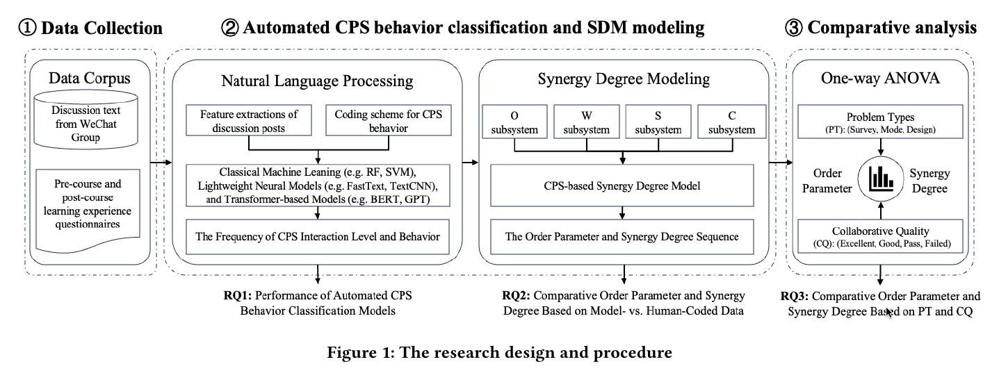
              
              Fig. 1 &middot; 研究流程
            </button>
            <button type="button" class="rg-figure-tile" data-zoom-group="lak26" data-zoom-img="/assets/img/photos/2026/figures/lak26-table3-models.jpg" data-zoom-caption="LAK26 · Table 3 — 大模型、神经网络与传统机器学习在 CPS 行为分类任务上的性能对比">
              
                表
                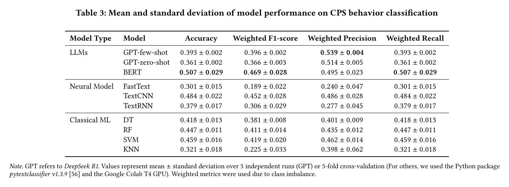
              
              Table 3 &middot; 模型对比
            </button>
            <button type="button" class="rg-figure-tile" data-zoom-group="lak26" data-zoom-img="/assets/img/photos/2026/figures/lak26-fig2-permutation.jpg" data-zoom-caption="LAK26 · Figure 2 — 模型编码与人工编码在各子系统序参量及整体协同度上的置换检验分布">
              
                图
                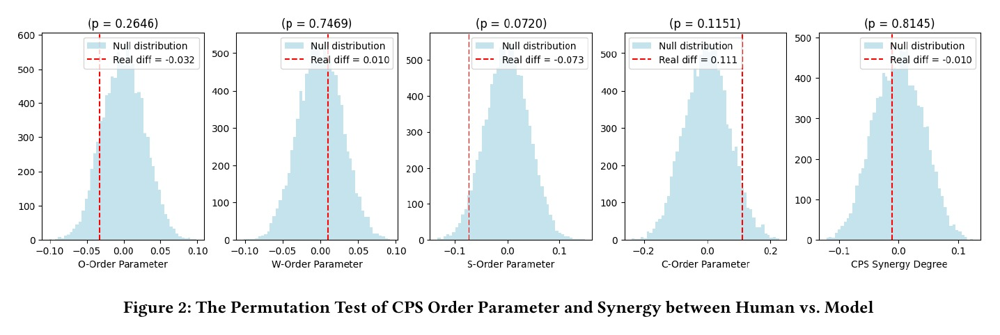
              
              Fig. 2 &middot; 置换检验
            </button>
            <button type="button" class="rg-figure-tile" data-zoom-group="lak26" data-zoom-img="/assets/img/photos/2026/figures/lak26-table5-synergy.jpg" data-zoom-caption="LAK26 · Table 5 — 不同问题类型（PT）与协作质量等级（CQ）下的序参量与协同度描述统计">
              
                表
                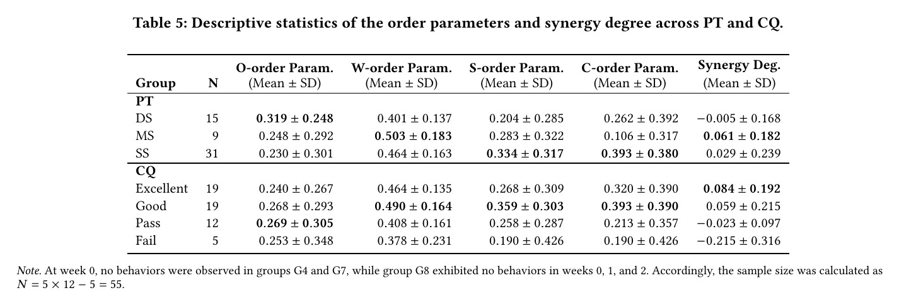
              
              Table 5 &middot; 协同度统计
            </button>
            <button type="button" class="rg-figure-tile" data-zoom-group="lak26" data-zoom-img="/assets/img/photos/2026/figures/lak26-table6-anova.jpg" data-zoom-caption="LAK26 · Table 6 — 问题类型与协作质量组间显著差异检验（Kruskal-Wallis 与 Fisher ANOVA）">
              
                表
                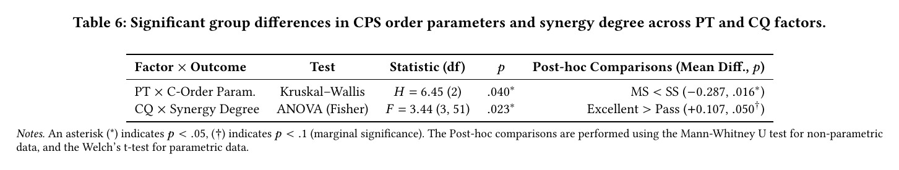
              
              Table 6 &middot; 方差分析
            </button>
          

        

      </article>

      <article class="rg-pub-entry">
        

          

            02
            Interactive Learning Environments &middot; 2026
            SSCI Q1 &middot; 独立作者
            被引 {{ c_ile26 }}
          

          

            <a class="rg-pub-entry__link" href="https://doi.org/10.1080/10494820.2026.2632766" target="_blank" rel="noopener">DOI &#8599;</a>
          

        

        <h3 class="rg-pub-entry__title">开放学习环境中的交互模式探索：融合网络动态与认知投入</h3>
        
<strong>Xiao, J.&dagger;</strong> &mdash; 基于 8 轮 cMOOC（1,939 名学习者、39,000+ 条交互事件）的关系事件建模，揭示互惠机制与认知投入的交互效应。

        

          

            论文 PDF 图表提取 &middot; 6
            

              <button type="button" class="rg-figures-nav" data-rg-prev aria-label="向左滚动图表">&#8249;</button>
              <button type="button" class="rg-figures-nav" data-rg-next aria-label="向右滚动图表">&#8250;</button>
            

          

          

            <button type="button" class="rg-figure-tile" data-zoom-group="ile26" data-zoom-img="/assets/img/photos/2026/figures/ile26-fig1-framework.jpg" data-zoom-caption="ILE (2026) · Figure 1 — 理论分析框架：融合网络动态（互惠性）与 CIE 联通主义认知投入的关系事件建模">
              
                图
                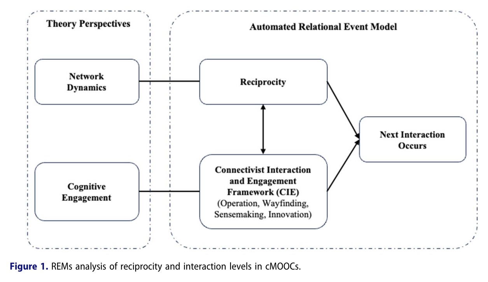
              
              Fig. 1 &middot; 理论框架
            </button>
            <button type="button" class="rg-figure-tile" data-zoom-group="ile26" data-zoom-img="/assets/img/photos/2026/figures/ile26-fig2-design.jpg" data-zoom-caption="ILE (2026) · Figure 2 — 研究设计图：NLP 自动 CIE 编码、关系事件建模（REM）与多元元分析">
              
                图
                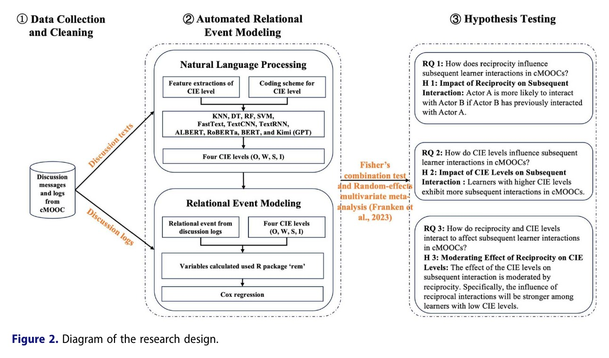
              
              Fig. 2 &middot; 研究设计
            </button>
            <button type="button" class="rg-figure-tile" data-zoom-group="ile26" data-zoom-img="/assets/img/photos/2026/figures/ile26-fig4-cie.jpg" data-zoom-caption="ILE (2026) · Figure 4 — 8 轮 cMOOC 课程中不同认知投入层级（CIE）发帖占比分布">
              
                图
                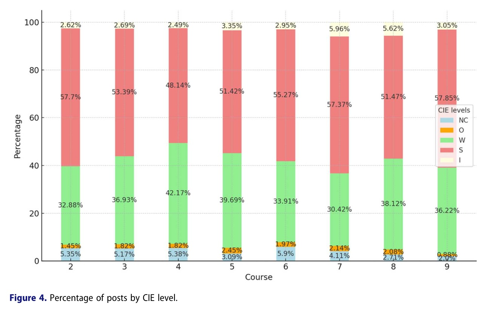
              
              Fig. 4 &middot; CIE 分布
            </button>
            <button type="button" class="rg-figure-tile" data-zoom-group="ile26" data-zoom-img="/assets/img/photos/2026/figures/ile26-fig5-marginal.jpg" data-zoom-caption="ILE (2026) · Figure 5 — 认知投入层级（CIE）与互惠性对后续交互影响的边际效应图（含局部放大）">
              
                图
                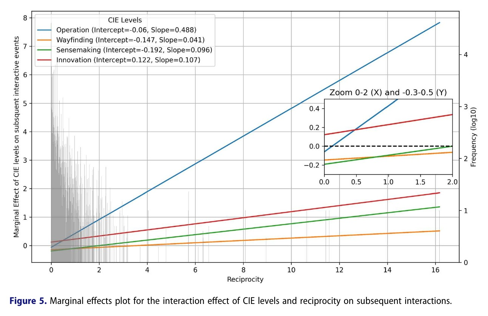
              
              Fig. 5 &middot; 边际效应
            </button>
            <button type="button" class="rg-figure-tile" data-zoom-group="ile26" data-zoom-img="/assets/img/photos/2026/figures/ile26-table2-rem.jpg" data-zoom-caption="ILE (2026) · Table 2 — 跨 8 轮课程的 REM 互惠性与 CIE 层级参数估计元分析结果">
              
                表
                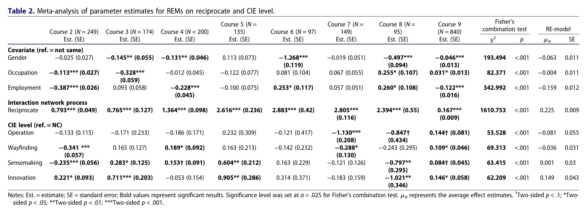
              
              Table 2 &middot; REM 元分析
            </button>
            <button type="button" class="rg-figure-tile" data-zoom-group="ile26" data-zoom-img="/assets/img/photos/2026/figures/ile26-table3-interaction.jpg" data-zoom-caption="ILE (2026) · Table 3 — REM 互惠性与认知投入交互效应的跨轮次元分析参数估计">
              
                表
                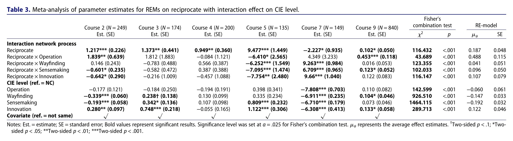
              
              Table 3 &middot; 交互元分析
            </button>
          

        

      </article>

      <article class="rg-pub-entry">
        

          

            03
            arXiv 预印本 &middot; 2026
            人机协同 &middot; DBR
            被引 {{ c_pca }}
          

          

            <a class="rg-pub-entry__link rg-pub-entry__link--muted" href="https://arxiv.org/pdf/2603.29285v2.pdf" target="_blank" rel="noopener">PDF &#8599;</a>
            <a class="rg-pub-entry__link" href="https://arxiv.org/abs/2603.29285v2" target="_blank" rel="noopener">arXiv &#8599;</a>
          

        

        <h3 class="rg-pub-entry__title">面向 cMOOC 讨论促进的人机交互设计：协同 AI-in-the-loop 工作流对社会与认知临场感的影响</h3>
        
<strong>Xiao, J.</strong>, &amp; Wang, C. &mdash; 两轮 DBR 构建人机协同促学系统 <em>FaciHub</em>，显著提升真实课程讨论中的社会临场感（<em>n</em> = 178）。

        

          

            论文 PDF 图表提取 &middot; 6
            

              <button type="button" class="rg-figures-nav" data-rg-prev aria-label="向左滚动图表">&#8249;</button>
              <button type="button" class="rg-figures-nav" data-rg-next aria-label="向右滚动图表">&#8250;</button>
            

          

          

            <button type="button" class="rg-figure-tile" data-zoom-group="pca26" data-zoom-img="/assets/img/photos/2026/figures/pca26-fig1-workflow.jpg" data-zoom-caption="arXiv (2026) · Figure 1 — FaciHub 超图选帖、多角色大模型生成与教师审核工作流架构">
              
                图
                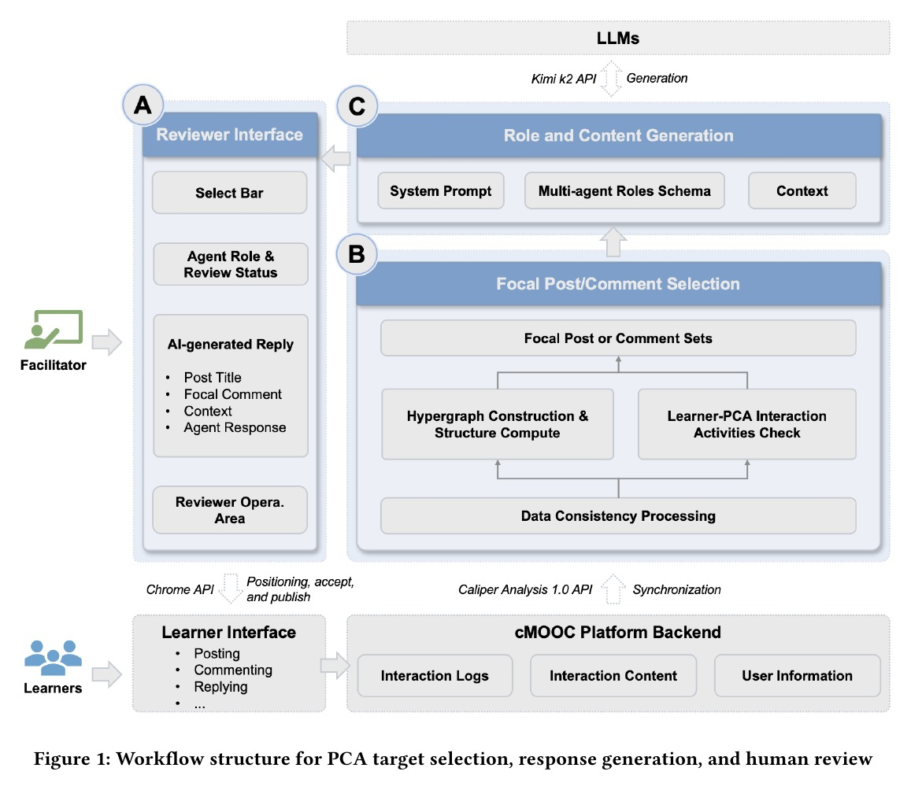
              
              Fig. 1 &middot; FaciHub 流程
            </button>
            <button type="button" class="rg-figure-tile" data-zoom-group="pca26" data-zoom-img="/assets/img/photos/2026/figures/pca26-fig2-interface.jpg" data-zoom-caption="arXiv (2026) · Figure 2 — FaciHub 语境检视与教师人工审核智能体回复的系统界面">
              
                图
                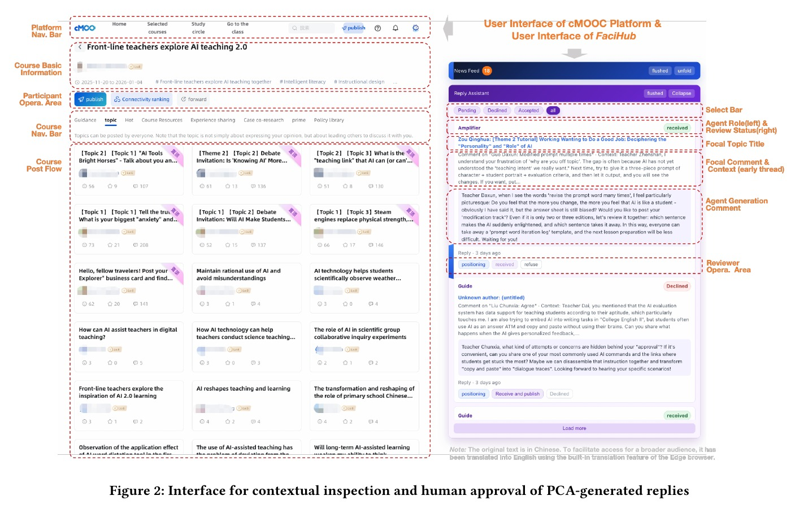
              
              Fig. 2 &middot; FaciHub 界面
            </button>
            <button type="button" class="rg-figure-tile" data-zoom-group="pca26" data-zoom-img="/assets/img/photos/2026/figures/pca26-fig3-hypergraph.jpg" data-zoom-caption="arXiv (2026) · Figure 3 — 基于超图结构识别智能体介入焦点帖子的选帖示例">
              
                图
                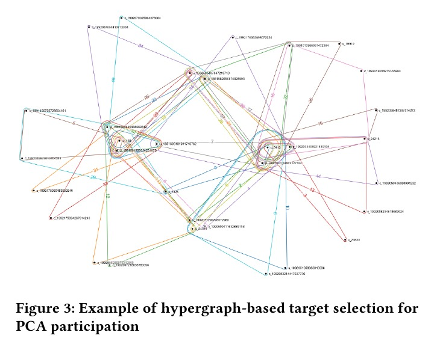
              
              Fig. 3 &middot; 超图选帖
            </button>
            <button type="button" class="rg-figure-tile" data-zoom-group="pca26" data-zoom-img="/assets/img/photos/2026/figures/pca26-fig4-dbr.jpg" data-zoom-caption="arXiv (2026) · Figure 4 — 遵循 Reeves (2006) 四阶段模型的两轮基于设计的研究（DBR）过程">
              
                图
                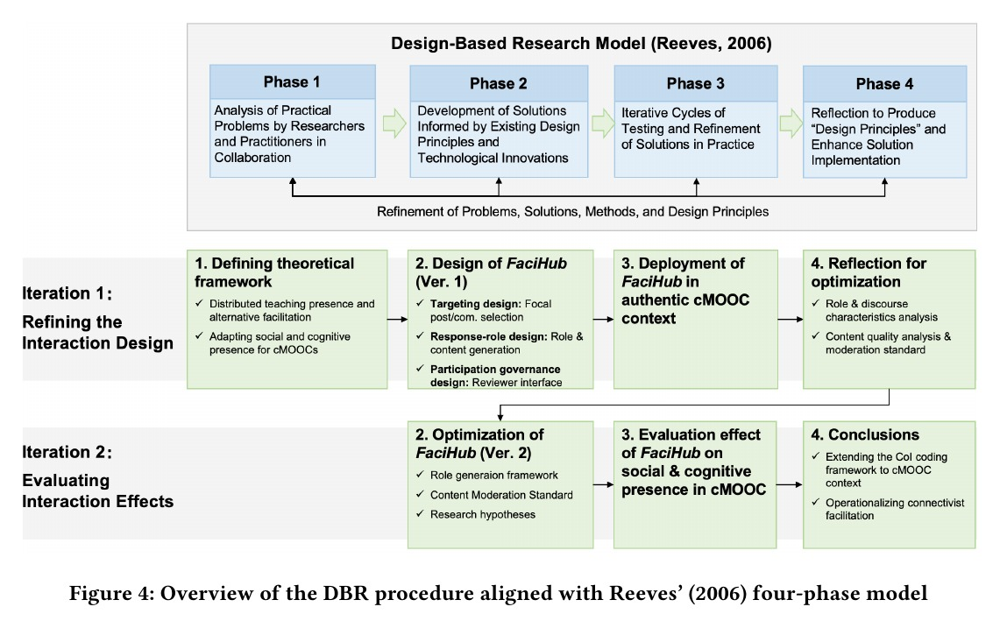
              
              Fig. 4 &middot; DBR 迭代
            </button>
            <button type="button" class="rg-figure-tile" data-zoom-group="pca26" data-zoom-img="/assets/img/photos/2026/figures/pca26-fig6-daily.jpg" data-zoom-caption="arXiv (2026) · Figure 6 — 智能体每日生成回复量、教师审核采纳率及教学角色分布变化">
              
                图
                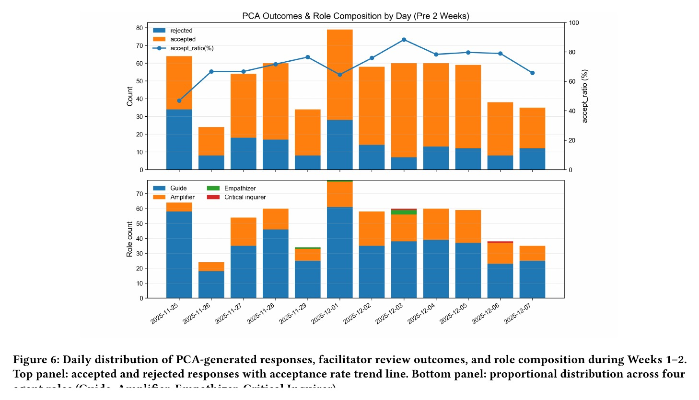
              
              Fig. 6 &middot; 每日结果
            </button>
            <button type="button" class="rg-figure-tile" data-zoom-group="pca26" data-zoom-img="/assets/img/photos/2026/figures/pca26-tables56-results.jpg" data-zoom-caption="arXiv (2026) · Tables 5 & 6 — 有无智能体及直接互动组在社会/认知临场感上的统计检验结果">
              
                表
                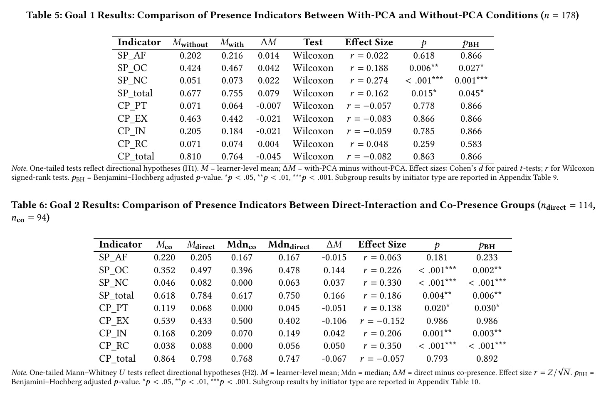
              
              Tables 5–6 &middot; 临场感检验
            </button>
          

        

      </article>
    

    
  </section>

  <section class="homepage-section" id="projects">
    

      

        
04 / 系统与工具

        <h2>代表项目</h2>
      

      <a class="homepage-section__link" href="/zh/projects/">查看全部 &rarr;</a>
    

    

      <article class="project-card">
        
        

          
01 &middot; WordPress &middot; 16,712+ 用户 &middot; 自 2019

          <h3>cMOOC 平台</h3>
          
面向联通主义在线课程的学习平台设计与迭代，支撑大规模协作学习社群实践。

          

            <a href="https://cmooc.bnu.edu.cn" target="_blank" rel="noopener">在线访问 &#8599;</a>
          

        

      </article>

      <article class="project-card">
        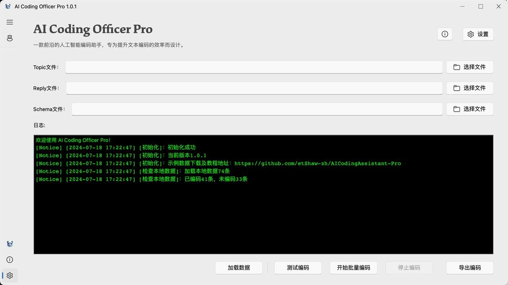
        

          
02 &middot; PyQt6 &middot; 开源工具 &middot; Win / macOS / Linux

          <h3>AICodingOfficer (AICO)</h3>
          
集成多分类器的跨平台 AI 文本编码助手，提升教育研究内容分析效率。

          

            <a href="/aicodingofficer/">项目主页 &rarr;</a>
            <a href="https://github.com/etShaw-zh/AICodingAssistant-Pro/releases" target="_blank" rel="noopener">下载版本 &#8599;</a>
          

        

      </article>

      <article class="project-card">
        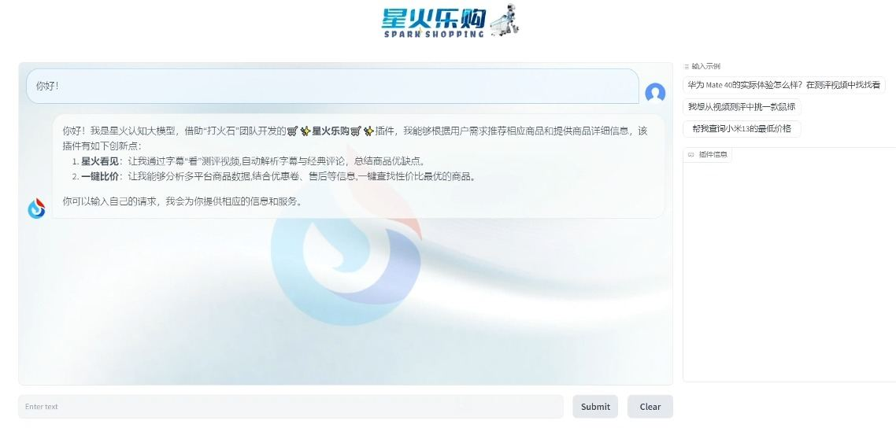
        

          
03 &middot; 大模型助手 &middot; 铜奖 &middot; 2023

          <h3>Spark Shopping</h3>
          
在讯飞星火训练营完成的大模型购物助手项目，并在通用人工智能创新与应用竞赛获奖。

          

            <a href="https://mp.weixin.qq.com/s/IGBmPkI9BBRgLGWiW0jFCQ" target="_blank" rel="noopener">获奖报道 &#8599;</a>
          

        

      </article>
    

  </section>

  <section class="homepage-section homepage-contact" id="contact">
    

      

        
05 / 联系

        <h2>与我交流</h2>
        
欢迎就科研合作、学术报告与期刊审稿随时联系 &middot; 北京师范大学远程教育研究中心。

        

          <a class="contact-chip" href="mailto:et_shaw@126.com">邮箱et_shaw@126.com</a>
          <a class="contact-chip" href="https://scholar.google.com/citations?hl=zh-CN&user=FaqCcFoAAAAJ" target="_blank" rel="noopener">Scholar被引 {{ total_citations }}</a>
          <a class="contact-chip" href="https://orcid.org/0000-0003-0000-9630" target="_blank" rel="noopener">ORCID0000-0003-0000-9630</a>
          <a class="contact-chip" href="https://github.com/etShaw-zh" target="_blank" rel="noopener">GitHub@etShaw-zh</a>
          <a class="contact-chip" href="https://linkedin.com/in/建军-肖-2947a6380" target="_blank" rel="noopener">LinkedIn主页 &#8599;</a>
          <a class="contact-chip" href="https://rcde.bnu.edu.cn/" target="_blank" rel="noopener">机构北师大 RCDE &#8599;</a>
        

        

          <a class="homepage-button" href="/assets/pdf/Xiao_Jianjun_Resume_CN.pdf">中文简历</a>
          <a class="homepage-button homepage-button--secondary" href="/assets/pdf/Xiao_Jianjun_Resume_EN.pdf">English CV</a>
        

      

      

        

          访客地图 &middot; Flag Map
          <a class="visitor-map-card__link" href="https://info.flagcounter.com/hnzv" target="_blank" rel="noopener">详情 &#8599;</a>
        

        
      

    

  </section>

